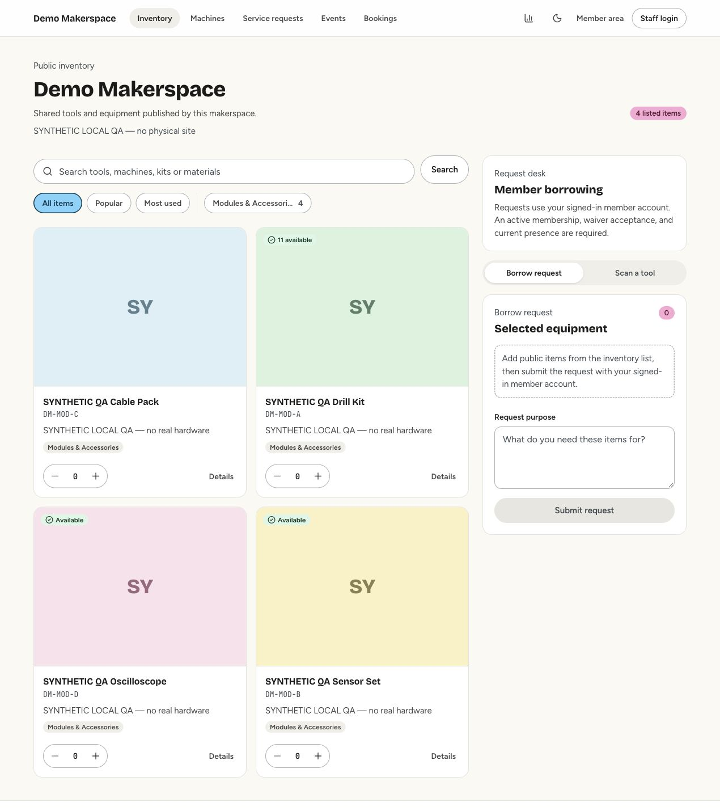
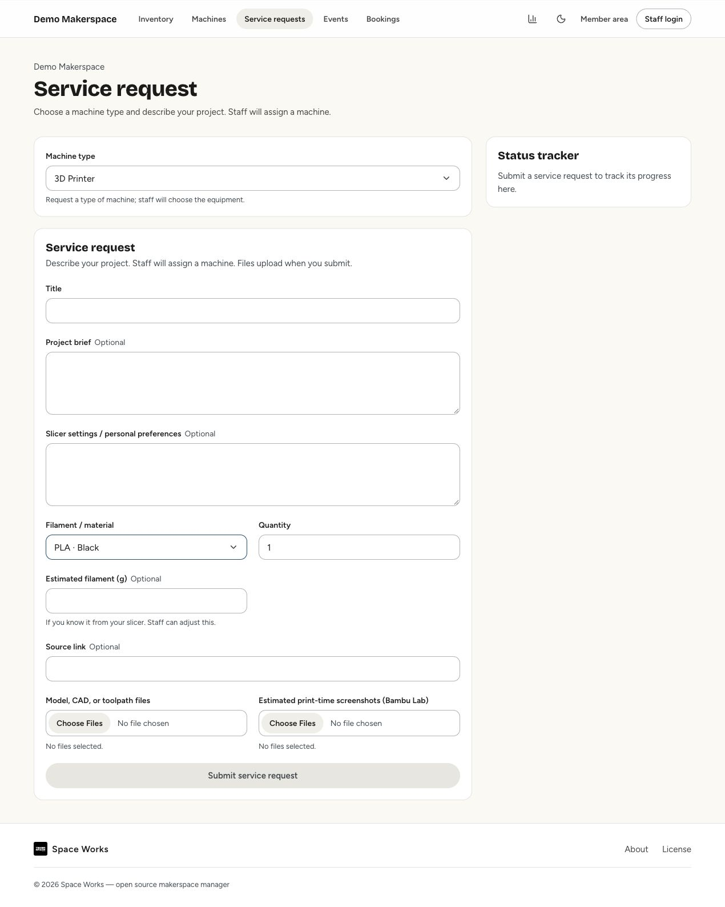
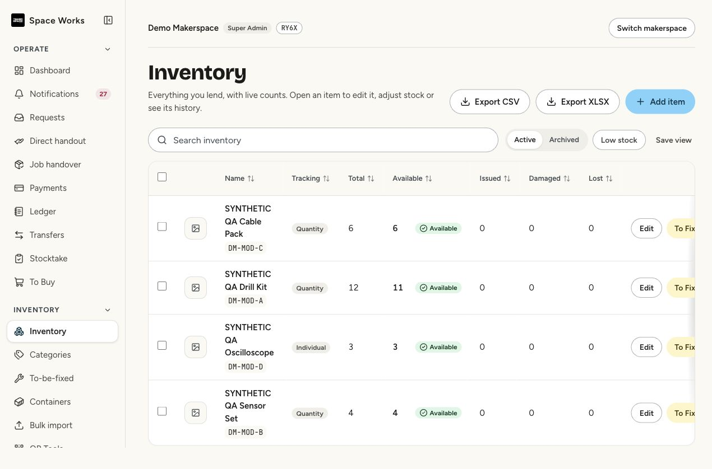
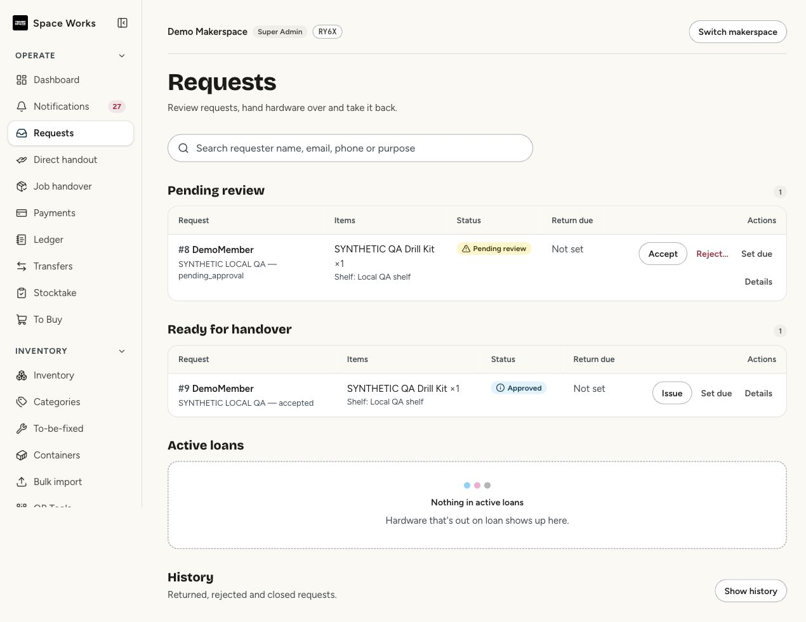

<div align="center">
  
  <h1>SpaceWorks</h1>
  <p>Inventory, equipment loans and day-to-day operations for makerspaces.</p>
  <p>
    <a href="LICENSE">AGPL-3.0-or-later</a> ·
    <a href=".github/CONTRIBUTING.md">Contribute</a> ·
    <a href="docs/self-hosting.md">Operator guide</a> ·
    <a href="docs/screenshots/README.md">Screenshots</a>
  </p>
</div>

> **Looking to use SpaceWorks at your own space?** Start with the official
> **[SpaceWorks-Labs/SpaceWorks](https://github.com/SpaceWorks-Labs/SpaceWorks)** project and its installation guide.
> This repository is **TinkerHub's customized edition for TinkerSpace**, including changes for its existing
> check-in and operational setup. Contributions to this edition belong in
> **[tinkerhub/SpaceWorks](https://github.com/tinkerhub/SpaceWorks)**.

SpaceWorks helps a community answer four practical questions: what equipment exists, what is available,
who has borrowed it, and what happened at each handover. Public visitors browse a makerspace's catalogue
and submit requests. Staff approve, issue and return equipment through shared workflows that preserve
stock counts, evidence and an audit history.

A deployment can serve multiple makerspaces. Each has its own inventory, staff permissions, public pages,
branding, machine types and enabled modules.

The current development version is **0.9.0**. The ongoing
[production-readiness audit](docs/audits/2026-10-29/CHANGE-REPORT.md) records completed fixes, verification
and outstanding work; the version number alone does not indicate that this unreleased batch is approved
for production.

## See it

These images show the current local application with labelled synthetic demonstration data. They are
screenshots, not design mockups. The [gallery and capture notes](docs/screenshots/README.md) distinguish
captured pages from views still awaiting verification.

| Public inventory | Machine service requests |
| --- | --- |
|  |  |
| **Staff inventory** | **Request review** |
|  |  |

## What it covers

| Area | Workflows |
| --- | --- |
| Inventory and lending | Public catalogue, quantity or individually tracked equipment, requests, approval, cancellation before handover, QR handover, returns, direct handouts, stocktake and transfers. |
| Machines | Machine types, status, operators, usage, maintenance, documents, service queues and consumables such as filament. Requesters choose a machine type; staff assign equipment. |
| Events and spaces | Events and recurring series, registration, waitlists, attendance, certificates and space bookings. |
| Members and organizations | Makerspace memberships, custom staff roles, optional profiles, organizations and scoped access. |
| Operations | Audit history, notifications, reports, exports, retention and operator recovery tools. External integrations need their own credentials and configuration. |

Modules are enabled per makerspace. See the [module reference](docs/MODULES.md) for the full list,
dependencies, defaults and what happens when a module is disabled or its data is purged.

Borrowing can require an authenticated account, allow an opted-in account-less flow, or use a verified
upstream check-in, according to the makerspace's configured policy. Check-in is a presence filter;
it is not authentication. My requests keeps private status links for account-free visitors; personal accounts
also have a Requests tab for their own hardware and machine history. See [check-in mode](docs/checkin-mode.md).

Reviewed handovers require issue evidence. Containers are optional; an assigned container requires its QR
scan, and individually tracked equipment always requires its asset scans. Returns require a photo and
notes. Evidence records and audit history preserve accountability even when image bytes expire under the
configured retention policy.

## Use SpaceWorks at your space

Use the **[official SpaceWorks repository](https://github.com/SpaceWorks-Labs/SpaceWorks)** for a general
installation. Its current installation and release instructions are the starting point for new operators.

If you operate this customized edition, read the [self-hosting guide](docs/self-hosting.md),
[production deployment guide](docs/deploy-production.md) and release upgrade notes before changing a live
installation. Keep the database, private storage, encryption keys and backup verification material together
in your recovery plan. A successful local test run does not replace a deployment-specific restore drill.

For a separate SPA and API, follow the [Netlify deployment guide](docs/deploy-netlify.md), including origin,
CORS and browser-facing object-storage configuration.

## Contribute to this edition

Start with a focused change: reproduce a bug, improve a confusing screen, add a missing behavioral test,
or clarify documentation. You do not need to understand every module before making a useful contribution.

1. Read the [contribution guide](.github/CONTRIBUTING.md) and [code of conduct](.github/CODE_OF_CONDUCT.md).
2. Fork this repository and branch from the latest `dev` for your contribution.
3. Follow the [development setup](.github/DEVELOPMENT.md) to run the application locally.
4. Read the relevant architecture rules in [AGENTS.md](AGENTS.md) and the
   [source map](docs/SOURCE-MAP.md). Open the relevant invariant section before changing a workflow.
5. Reproduce the behavior, make the smallest useful fix, and run the relevant checks. Include the commands
   and results in your pull request; report environmental failures explicitly.
6. Open a focused pull request against `dev`, explaining the problem, resulting behavior and validation.
   Use the [pull request template](.github/PULL_REQUEST_TEMPLATE.md).

For work on the general product, contribute to
[SpaceWorks-Labs/SpaceWorks](https://github.com/SpaceWorks-Labs/SpaceWorks) instead. For issues specific
to TinkerSpace's setup, use this repository. Report security concerns through the
[security policy](.github/SECURITY.md), rather than posting sensitive details in a public issue.

### Local development

Prerequisites: Git, Docker and a recent Docker Compose plugin. Docker supplies the application toolchains.
Follow [.github/DEVELOPMENT.md](.github/DEVELOPMENT.md) to create and configure your local `.env` before
starting services; do not commit credentials.

```bash
git clone https://github.com/tinkerhub/SpaceWorks.git
cd SpaceWorks
cp .env.example .env
# Configure .env as described in .github/DEVELOPMENT.md.
./scripts/dev-docker.sh up -d --build
```

Default development addresses are the public frontend at `http://localhost:5000`, API at
`http://localhost:8000/api`, Swagger at `http://localhost:8000/docs/`, and the superadmin control plane at
`http://localhost:8000/control/`. Local overrides may change these ports. Staff use the frontend's `/admin`
routes; `/control/` is a separate superadmin surface.

The [development guide](.github/DEVELOPMENT.md) contains the database-owner and encryption-key requirements
for backend tests. Use **Node 20** for the frontend regression suite and plain `tsc -b` for type checking.
Run only one pytest process per test database. The complete suite is substantial; focused tests are useful
while developing, followed by the required full checks before delivery.

### Find the code

| Path | Responsibility |
| --- | --- |
| `backend/apps/` | Django models, API boundaries, permissions and workflow services. |
| `frontend/src/features/` | Public and staff screens, mutations and server-state handling. |
| `frontend/src/components/` | Shared UI primitives and application chrome. |
| `backend/tests/` and frontend `*.test.*` files | Behavioral and regression coverage. |
| `docs/` | Operator guides, architecture, invariants and audit records. |
| `scripts/` and `deploy/` | Host operations, deployment and recovery entry points. |

The request workflow owns state transitions. Inventory availability owns quantity arithmetic. All tenant
queries must enforce makerspace scope. Build on these shared services so API, web and control-plane
behavior remain consistent.

## Documentation

- [Development setup](.github/DEVELOPMENT.md) and [repository workflow](docs/DEV-WORKFLOW.md)
- [Source map](docs/SOURCE-MAP.md), [invariants](docs/INVARIANTS.md) and [project status](docs/PROJECT-STATUS.md)
- [Modules](docs/MODULES.md), [staff roles](docs/staff-roles.md) and [item codes](docs/item-codes.md)
- [Check-in configuration](docs/checkin-mode.md) and [notification setup](docs/notifications-setup.md)
- [Self-hosting and upgrades](docs/self-hosting.md), [production deployment](docs/deploy-production.md)
  and [Netlify/API split deployment](docs/deploy-netlify.md)
- [Screenshot gallery](docs/screenshots/README.md) and [current audit report](docs/audits/2026-10-29/CHANGE-REPORT.md)

## Technology

Django 6 and Django REST Framework; React 19, TypeScript and Vite 8; TanStack Query, Tailwind CSS 4 and
Radix UI; PostgreSQL 16; Celery and Redis; S3-compatible object storage. The API schema uses
drf-spectacular. See the development guide for supported toolchain versions and configuration.

## License and contributors

This edition is licensed under **[AGPL-3.0-or-later](LICENSE)**. The official project's license is available
at **[SpaceWorks-Labs/SpaceWorks — LICENSE](https://github.com/SpaceWorks-Labs/SpaceWorks/blob/main/LICENSE)**.
Read the license text for its terms.

Thank you to the people contributing code, documentation, bug reports and operational experience.
See the [contributor credits](.github/CONTRIBUTORS.md) and
[TinkerHub repository contributor graph](https://github.com/tinkerhub/SpaceWorks/graphs/contributors).
