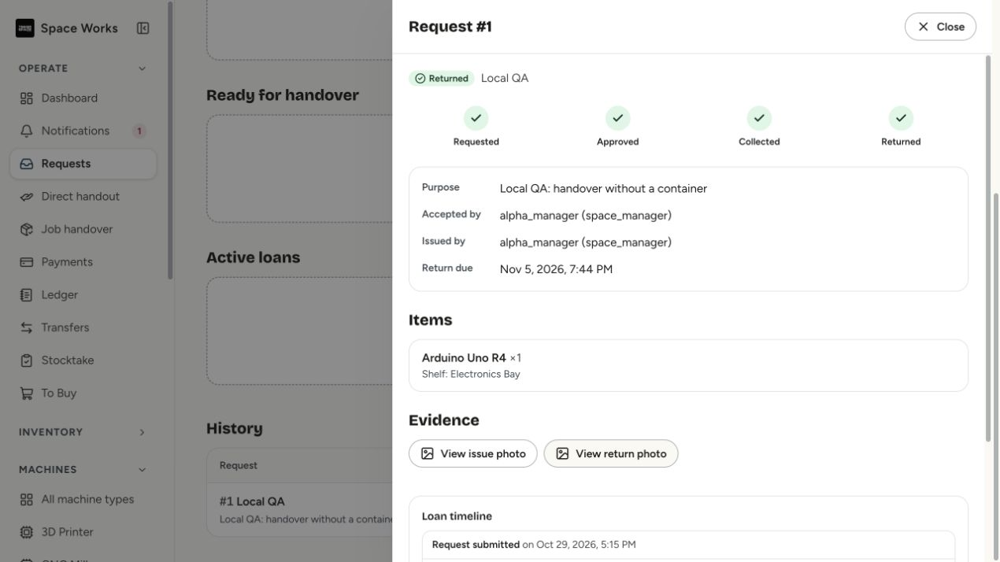
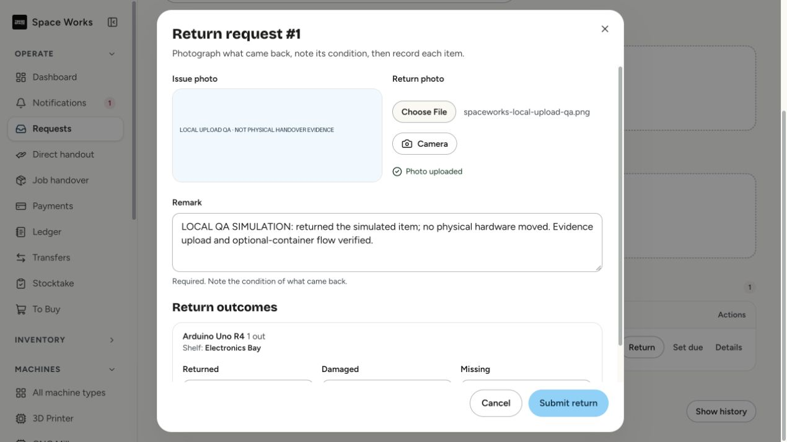
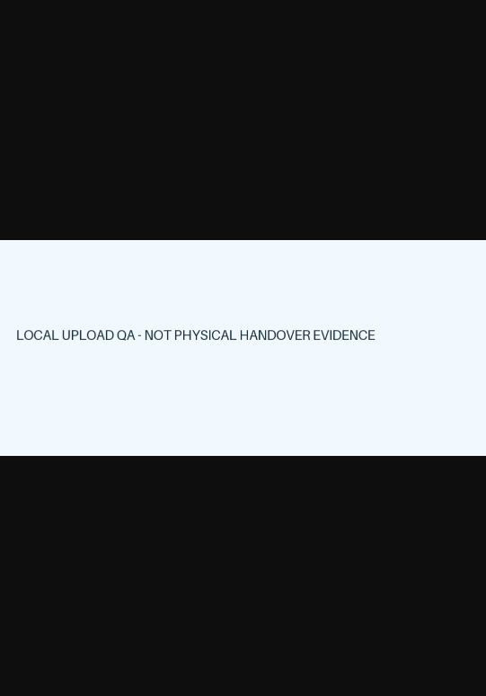
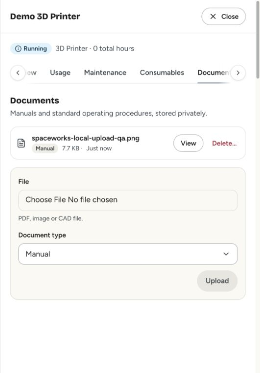

# Local browser verification

Verified against the updated localhost application on 2026-10-29 with Alpha Robotics Lab synthetic QA records. No physical hardware moved, production records changed, real payments made or real messages sent.

- A labelled local QA request issued without a container after evidence upload, then returned with a second uploaded photo and explicit simulation remarks.
- Return comparison loaded the private issued photo; a signed return-photo preview also rendered the labelled image.
- History reported Returned with Requested → Approved → Collected → Returned steps and actor/evidence timeline.
- A private machine document uploaded through the resource-bound presign/finalize path and rendered through its signed read URL; the local synthetic file remains labelled for QA.

These are representative browser checks, not proof that every provider, browser or configuration has been manually exercised.

